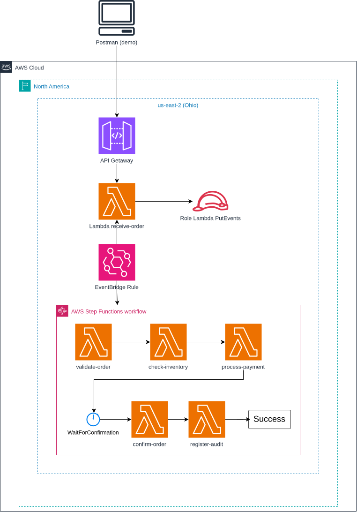
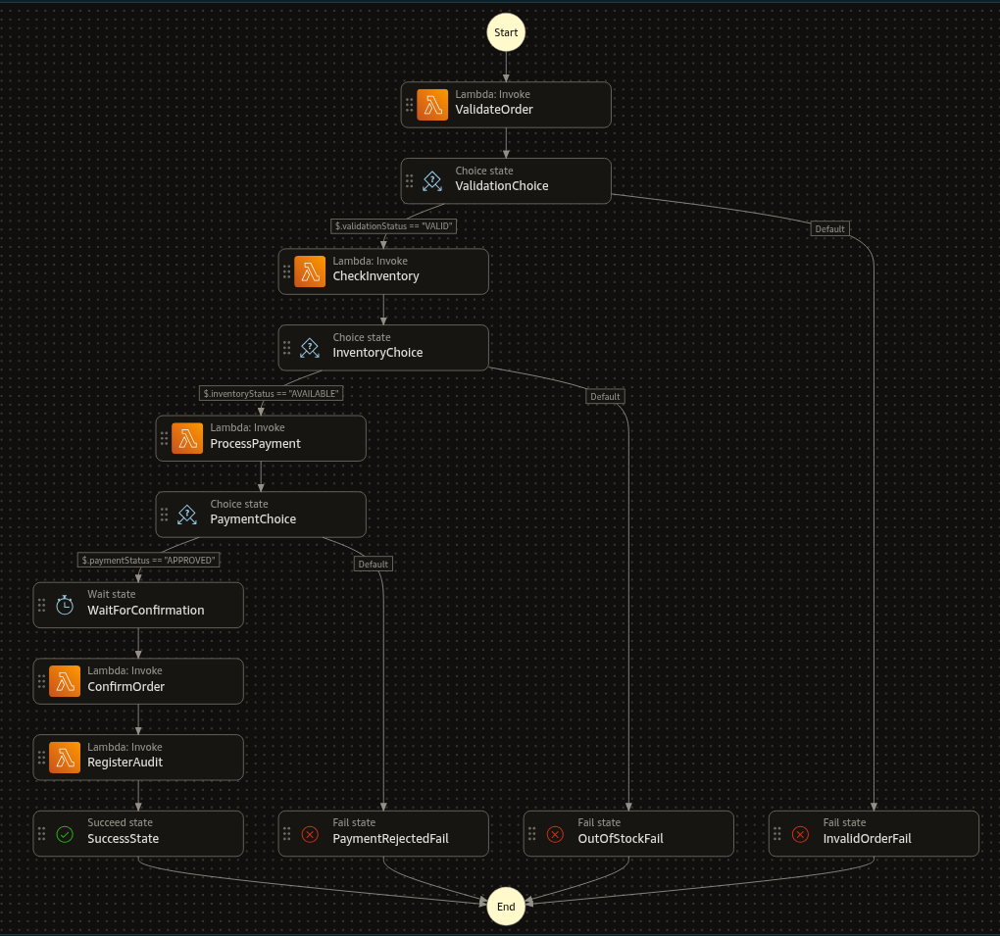
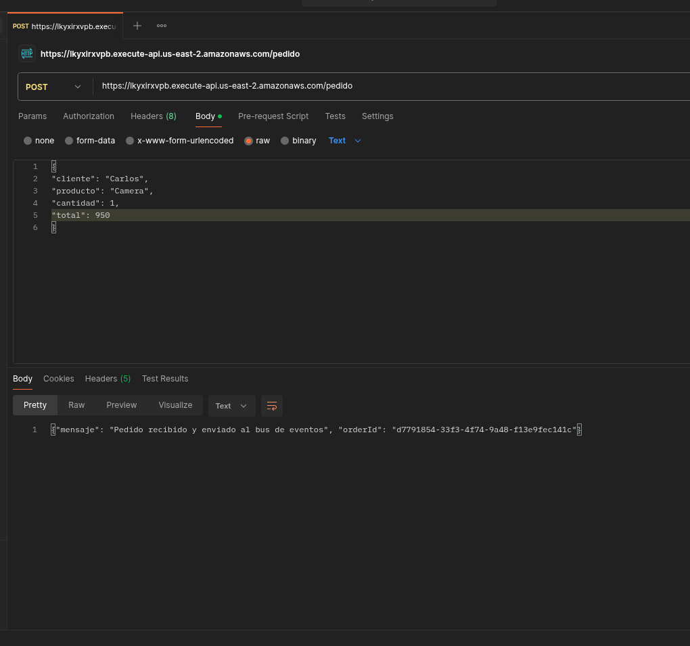
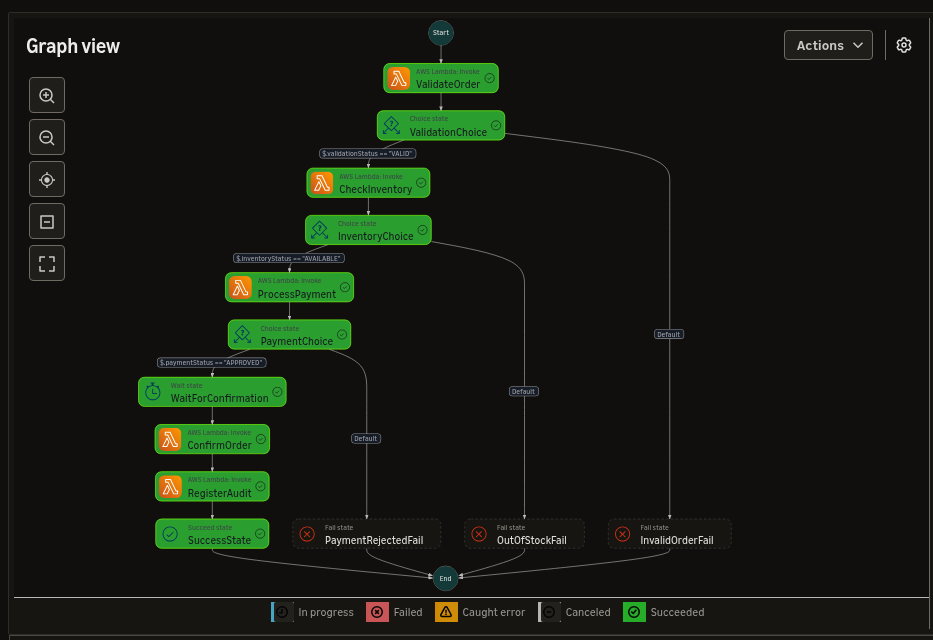

## Automatizacion de solicitudes con API Getway, EventBridge y Step Funtions

- Se tiene la siguiente Arquitectura de servicios :

- Donde se busca automatizar las solicitudes que llegan a un e-commerce/tienda.

### Flujo de trabajo

- En este servicio, primero tenemos un API Getway que crea una solicitud de tipo POST hacia el endpoint "/pedidos" de la Lambda receive-order, esta lambda a su vez crea el cuerpo de la solicitud del pedido y crea un evento para que la regla de EventBridge inicie el workflow de StepFunctions.
- Asi se ve el workflow de Stepfunctions:

- En este flujo de trabajo, tenemos la lambda validate-order que como su nombre lo indica valida si el cuerpo de la orden es correcto, si es asi continua con el flujo, de lo contrario, manda un estado de fallo y  termina la ejecucion del flujo. 
- Despues tenemos check-inventory que chequea inventario, y decide si hay para cumplir la solicitud o no.
- Luego process-payment procesa el medio de pago, y si este es el correcto espera a confirmacion del pago.
- Cuando el pago es confirmado, confirm-order confirma el pedido y llama register-audit para registrar la compra en el historial para futuras auditorias.
- Y pasamos a un estado de completado.

Para esta demo se utilizo Postman como cliente de la API, aqui las evidencias de ejecucion y funcionamiento:

- Como podemos ver la api nos devuelve un mensaje de confirmacion,  junto con el "id" del pedido y lo envia al bus de eventos que inicia nuestro flujo de trabajo.
- Aqui podemos ver la correcta ejecucion de nuestro flujo de trabajo:

